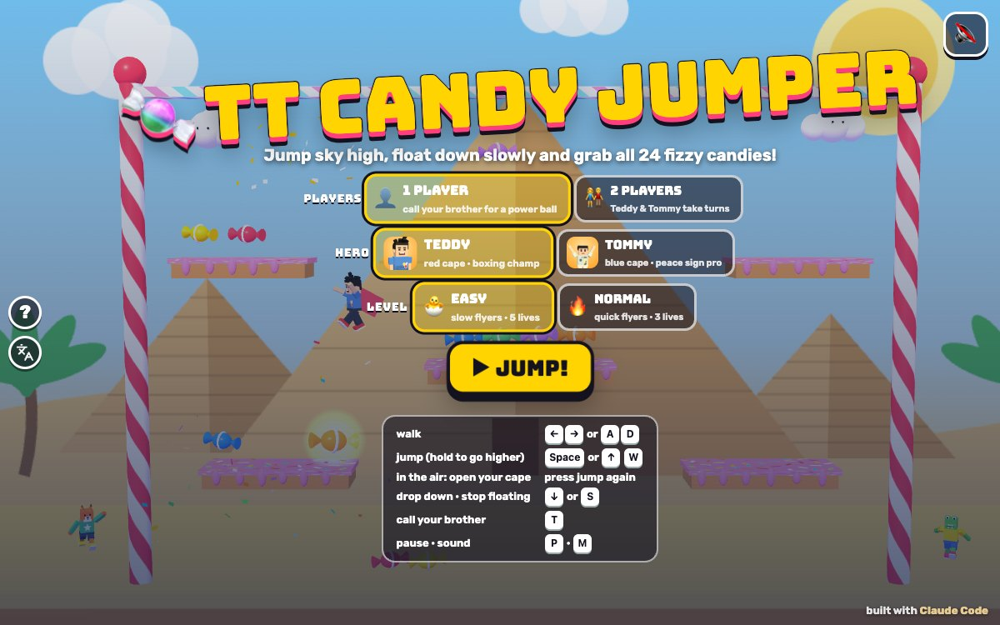

# TT Candy Jumper

Press **?** any time (or tap the round **?** button on the left edge) to see the keys. The game waits while you look.
Tap the language button under it (the A文 icon) to switch between English and 中文; the dashboard and every game remember the choice.

A one-screen arcade jumper starring Teddy and Tommy in superhero capes. Jump sky high (hold the jump key to go higher), press jump again in the air to open your cape and float down slowly, and grab all 24 fizzy candies on the screen. The next candy in the order glows: grab the glowing one each time for a big bonus. Silly birds and propeller robots fly about and bump you (you get dizzy, nobody gets hurt); grab the wobbly rainbow power ball and every flyer turns into a smiley coin for a few seconds. Each screen sits in front of a landmark: a pyramid in the desert, a castle on the hills, a city at night and a rocket base. 🦊 Foxy and 🐸 Froggy cheer at the sides.

**中文：** 跳跳糖果：Teddy 和 Tommy 披着披风跳得高高的！按住跳键跳得更高，在空中再按一下就打开披风，慢慢飘下来。把屏幕上 24 颗跳跳糖果全抓到就过关。按顺序，下一颗糖果会发光：每次都抓发光的那颗，奖励更多。傻傻的小鸟和螺旋桨机器人飞来飞去，被撞到会晕乎乎的（谁也不会受伤）；抓住摇摇晃晃的彩虹能量球，它们就全变成笑脸金币。四个画面：沙漠里的金字塔、山上的城堡、夜晚的城市和火箭基地。

A 3D game for the boys, built with Claude Code from plain JavaScript and Three.js on the shared Claude Games kit. The heroes are the kit's blocky Teddy and Tommy with capes added here; Foxy and Froggy are built on the kit's bear (copied from TT Balloon Bump); the birds, the robots, the coins, the landmarks and everything else are our own. There are no image, model or audio files: every texture is painted on a canvas and every sound is synthesised. The name, the characters, the art and the sounds are our own. Nobody gets hurt: a bump makes you dizzy with stars round your head, and flyers puff away in a little cloud or turn into coins.

## Play

- **Double-click `index.html`.** It works offline because Three.js and the kit are copied into `kit/`. Without internet the title font falls back to Arial Black.
- **Send one file:** `dist/candy-jumper-tt.html` is the whole game in one page, about 830 KB. AirDrop or email it, then open it in a browser.
- Rebuild that file after any edit: `python3 kit/tools/bundle.py . --name candy-jumper-tt`

On the title screen pick **1 PLAYER** (then the hero: Teddy in a red cape or Tommy in a blue one) or **2 PLAYERS** (Teddy and Tommy take turns), the level, and press **▶ JUMP!** Behind the menu the autopilot plays a demo.

**Levels:**

- **🐣 EASY** (the default, for Tommy, 5): 5 lives, slower flyers (one at the start, never more than three), the cape floats down at 1.8 m/s, and the power ball lasts 8 seconds.
- **🔥 NORMAL** (for Teddy, 8): 3 lives, quicker flyers (two at the start, up to five), a slightly faster float (2.2 m/s), and the power ball lasts 5.5 seconds.

An extra life comes every 50,000 points. Each time round the four screens, the flyers get a little quicker.

## The candies

- **24 candies** on every screen: on the platforms, on the floor, up the walls and high in the air. Grab all 24 and the screen is done: **ALL 24 CANDIES!**, your hero does his signature move, confetti, Foxy and Froggy jump for joy, and the next screen starts.
- **The order:** the candies are in an order. At the start the first one glows. Whenever you grab a candy, the glow moves to the next candy after it in the order that is still there (skipping eaten ones, and going round to the start). So if you always grab the glowing one, you follow the whole chain; grab another one and the chain carries on from that one instead.
- **Points:** a candy 100, the glowing one 300 (**IN ORDER!**). At the end of the screen each glowing candy is worth 500 more, and all 24 in order is **PERFECT ORDER!** with 10,000 more.
- **The power ball** comes out of the top after 8 and after 17 candies (and whenever your brother lights one). It wobbles and bounces about for 12 seconds. Touch it (+1,000) and every flyer turns into a smiley coin for a few seconds: coins don't bump, and each one you touch is worth double the last (200, 400, 800, 1,600, 3,200). The last 1.5 seconds the coins blink, then they turn back with a BOING.
- **Flyers** pop out of the two smiling clouds at the top. Birds fly in straight lines, bouncing off the edges and sometimes changing their mind; robots chase you, a bit too fast to stop, so they swing past. A bump: dizzy stars, a life gone, every flyer puffs away, and you are back in the middle of the floor, blinking and safe for 2.2 seconds.
- **HI-SCORE:** the best score for each level is kept on this device.

## Moving

- **Walk** with ← → (or A D). In the air you can steer too.
- **Jump** with Space (or ↑ or W). Hold it to go higher: a tap is about 3 m, holding it about 9 m (most of the screen).
- **Press jump again in the air** to open your cape: you stop going up and float down slowly, arms out, the cape spread wide, steering where you like. You land softly.
- **↓** (or S) drops you down through the platform you stand on. You can always jump up through a platform from below and land on top, so nobody gets stuck under one. In the air, ↓ closes the cape and you fall faster.
- The candy-cane poles are the walls; the striped bar at the top is the ceiling.

## 2 players

Teddy and Tommy take turns, like the old arcades: each brother has his own screen, candies, score and lives. When the one playing gets bumped, it's the other one's turn (**TOMMY'S TURN!**); either set of keys (or the touch buttons) moves whoever's turn it is. When one brother is out of lives the other plays on. **T** is a **HIGH FIVE! ✋** (the waiting brother pops in, +50). At the end the higher score wins, and the results show both scores and the team total.

## Controls

| | Keys | Touch |
|---|---|---|
| walk | ← → or A D | ◀ ▶ |
| jump (hold to go higher) | Space, ↑ or W | the big ⬆ |
| in the air: open the cape and float | press jump again | tap ⬆ again |
| drop through a platform · stop floating | ↓ or S | ▼ |
| call your brother (2 players: high five) | T (or Enter) | his face (2 players: ✋) |
| pause · sound | P or Esc · M | ❚❚ · 🔊 |

- **Touch:** the buttons show up on phones and tablets, clear of the kit's buttons on the left edge. On a phone held sideways ▼ sits above ◀ ▶ and your brother above JUMP, so the screen gets more room; on a phone held upright your brother sits above JUMP.
- **Menus:** on the title screen 1 and 2 pick the players, E and N the level, C (or ← →) swaps the hero, Enter or Space starts. Paused: P or Esc go on, Q goes to the menu. Results: Enter plays again, Esc goes to the menu.

## Call your brother (companion mode)

Call the other brother (`Kit.roster.buddyFor`: Tommy for Teddy, Teddy for Tommy) with **T**, by tapping his face button, or by clicking his face under your score, **as often as you like**: there's no waiting, and calls while he's here queue up (up to three more visits).

- **He pops in** in a puff of confetti next to you, on the floor or on your platform, at his roster `buddyScale`, in his own cape.
- **He does his signature move:** Tommy's Y with peace fingers ✌️; Teddy's boxing, or (on the next call) his jump shot with a 🏀.
- **He tosses you a treat** (🍦 💧 🧃 🍪 🍉 🍌, a different one each call): +100.
- **Then the game's helper:** "TOMMY SAYS: POWER BALL FOR YOU!" He holds both hands up and lights a wobbly power ball right above him, then waves and puffs away. Each call is another power ball.
- **2 players:** the waiting brother pops in for a high five instead.

## The end

When the last lives are gone, the winner (the higher score) stands in the middle of the floor and does his signature move in a shower of confetti, then the results show the scores, the candies each brother grabbed, the round reached, the HI-SCORE (**⭐ NEW HI-SCORE!**) and **↻ PLAY AGAIN**.

## How it works, and how it's tested

- `js/levels.js`: the four screens as plain data (platforms and the 24 candies in their order). `js/sim.js`: the rules in fixed 1/120 s steps (walking, jumping and holding, the cape, platforms, the glowing order, flyers, the power ball and coins, bumps and lives, the brother, and the 2-player match). `S.advance` turns any frame time into whole steps. `js/bot.js`: the autopilot. None of them uses Three.js, so node runs them.
- `js/art.js` builds the landmarks and everything on the screen, `js/sfx.js` the sounds (all through `Kit.sound`, so the mute switch covers them; counted in `CJ.sfx.log`), `js/game.js` the camera, screens, keys, touch, HUD, celebrations and the test hooks. `js/friends.js` adds Foxy and Froggy. The name lives in `js/title.js`.
- **The headless check:** `node tools/check.js` (or `game.check()` in the page), 10 checks in under a second:
  - *glowOrder:* on all four screens, 288 grabs in a mixed order (half the glowing one, half a random one): after every grab the glow is on the next uneaten candy after it in the order, wrapping round; the glowing one pays 300 and the others 100; always grabbing the glowing one makes 24 of 24 and the perfect bonus.
  - *roundEnds:* on all four screens the hero touching 23 candies keeps the round going, the 24th clears it, and the next screen starts with 24 fresh candies.
  - *jumpFps:* the same script of walking, a held jump, a float, ↓, a tap jump, another float and a medium jump, played at 30, 60 and 120 fps through `S.advance`, gives exactly the same path (largest difference 0 m), the same top of the jump to the millimetre and the same float speed, on EASY and NORMAL.
  - *holdAndFloat:* a tap goes 3.2 m, holding 9.1 m; the cape falls at exactly 1.8 (EASY) or 2.2 (NORMAL) m/s, under a third of a normal fall, and closes on landing.
  - *platforms:* every platform on every screen: up through it from below, land on top, ↓ drops through, walking off the edge falls; the floor holds.
  - *coins:* the power ball turns all four flyers into coins; two coins give 200 then 400; a coin never bumps; after the power time they fly again.
  - plus bumps and lives (EASY 5, NORMAL 3, then game over), the brother (Teddy for Tommy, treat, "SAYS", a power ball; three more calls make three more balls; 2 players: a high five, no ball), 2-player turns (Teddy, Tommy, Teddy...; one out, the other plays on), and the autopilot grabbing all 24 candies on every screen on both levels (no flyers), so nothing is out of reach.
  - **It can fail:** `node tools/check.js --fail` (or `game.checkFail()`) switches on six sabotages one at a time (the glow goes to the lowest uneaten candy, the round ends at 23, a jump or a float as strong as the frame is long, a power ball that leaves the flyers alone, a brother who never lights a ball) and every one is caught.
- **The real-key play check:** `game.playCheck()` in the page (1,770 checks, under 2 seconds) presses keys with real `keydown`/`keyup` events on `window` and taps the touch buttons with pointer events, never the autopilot, and reads where the hero's 3D body is drawn on the screen. On all four screens, EASY and NORMAL, for Teddy (arrows and A D) and Tommy in 1 player, each brother's turn in 2 players, and touch: → moves right on screen, ← moves left, jump moves up, a second press opens the cape and he floats down at the cape's speed, and steering works in the air. Nothing leaves you stuck: on the floor against each wall, on every platform (walk both ways, jump off, ↓ drops through), after a bump and the dizzy spell, during and after the brother's visit, a key let go during the pause, a blur, the next screen after all 24 candies, the turn passing in 2 players, and a "keyboard kid" mashing keys for 8 s; holding the touch ⬆ jumps more than twice as high as a tap. `game.playCheck('mirror')` (← and → swapped in the input layer) and `game.playCheck('stuck')` (frozen whenever he stands on a platform) both fail it (`game.playCheck.prove()`).
- **In the browser** (headless Chrome over the DevTools protocol, `tools/shoot.js` with the step files in `tools/`, the page opened from the disk): every screen in 中文 (`tools/zh.json`: `Kit.lang.untranslated()` returns `[]` on 31 screens and moments: the title in 1 and 2 players and with touch, the ? panel, the round banner and all four screens, candies, the float, the power ball, coins, the brother, bumps by a bird and a robot, the puff, READY?, an extra life, the screen clear, PERFECT ORDER, pause, the high five, the turn passing, one brother out, and the results in 1 player, 2 players and a tie; a planted English line is caught), no Chinese in English mode, phone 390x844, 740x360 and 844x390, iPad 768x1024, 1024x768 and 820x1180, and 1200x750, with touch and keys (`tools/layout.json`: no button over another, nothing over the play area, the kit's left-edge buttons clear of the play area and the touch buttons, no scrolling, the smallest tap target 56 px), and `dist/candy-jumper-tt.html` from `file://` (`tools/dist.json`: boots with no script files, real frames run the demo, the ? panel freezes the game, the play check, its sabotages, the headless check and its sabotages all pass there, no page errors).
- `docs/screenshot.jpg` is the title at 1200x750: `node tools/shoot.js tools/shots.json docs 1200 750`.

## Not verified

- **Sound:** every sound is synthesised and counted in code, but nobody has listened to it (tests ran muted): the jumps, the cape's whoosh, the candy fizz, the coins, the dizzy bonk.
- **Real devices:** touch was driven with synthetic pointer events in emulated phones and iPads, not on a real iPad or iPhone. The frame rate was only seen in software rendering (about 240 draw calls a frame with five flyers), not on an older iPad. On a phone held upright the screen is small; the title asks to turn it sideways.
- **Real kids:** how hard EASY and NORMAL feel was tuned with the autopilot (which clears a screen in 10 to 20 seconds and keeps going for many screens on both levels), not with Teddy and Tommy.
- **Long sessions,** a real Finder double-click, the home-screen icon on a real iPad, and the offline font fallback.
